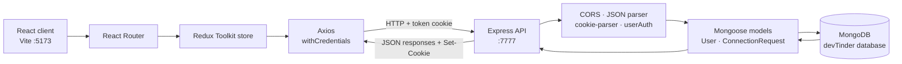
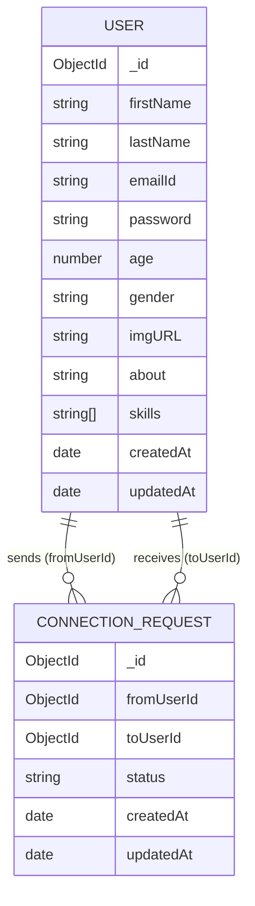

<div align="center">

# DevTinder

### Find your people. Build your developer network.

Discover developers, share a profile, and turn mutual interest into meaningful connections.

[](https://react.dev/)
[](https://vite.dev/)
[](https://expressjs.com/)
[](https://mongoosejs.com/)
[](https://developer.mozilla.org/en-US/docs/Web/JavaScript)

[Repository](https://github.com/tejendrathakur061/DevTinder) · [Report an issue](https://github.com/tejendrathakur061/DevTinder/issues)

</div>

## Table of Contents

- [Project Overview](#overview)
- [Key Features](#features)
- [Screenshots](#screenshots)
- [Tech Stack](#tech-stack)
- [Architecture](#architecture)
- [Project Structure](#project-structure)
- [Installation and Setup](#installation-and-setup)
- [Environment Variables](#environment-variables)
- [API Reference](#api-reference)
- [Authentication and Security](#authentication-and-security)
- [Database Design](#database-design)
- [Application Workflow](#application-workflow)
- [Available Scripts](#available-scripts)
- [Future Improvements](#future-improvements)
- [Contributing](#contributing)
- [License](#license)
- [Author](#author)

<a id="overview"></a>
## 🌱 Project Overview

DevTinder is a full-stack networking application for developers. Members can create and update a profile, browse a feed of other developers, express interest or pass, review incoming requests, and see accepted connections.

The project brings profile discovery and connection requests into one simple workflow. It helps developers find potential peers without relying on informal, scattered introductions.

> **Project status:** The repository contains a working client and server implementation. There is no separate admin interface or admin authorization flow in the inspected source.

<a id="features"></a>
## ✨ Key Features

### Member features

- **Account creation and login** — sign up with basic profile details and log in with email and password.
- **Editable developer profile** — update name, age, gender, bio, image URL, and skills.
- **Developer discovery feed** — browse profile cards and choose **Interested** or **Ignore**.
- **Incoming request review** — accept or reject requests from other members.
- **Connections list** — view users whose requests have been accepted.
- **Session-aware navigation** — protected data is requested with the login cookie; unauthenticated visits to private views are redirected to login.
- **Client-side state** — Redux Toolkit stores the current user, feed, requests, and connections for the active app session.

### Admin features

No admin-specific screens, roles, or endpoints are implemented in the inspected code.

<a id="screenshots"></a>
## 🖼️ Screenshots

Screenshots are not included in the repository yet. Replace the clearly labeled placeholders below with committed image files when they are available.

| Screen | Preview |
| --- | --- |
| Developer discovery feed | `Screenshot placeholder — add the feed screenshot here` |
| Profile editing | `Screenshot placeholder — add the profile editor screenshot here` |
| Requests and connections | `Screenshot placeholder — add the requests/connections screenshot here` |

<a id="tech-stack"></a>
## 🧰 Tech Stack

| Area | Technologies used |
| --- | --- |
| Client | React 19, React Router 7, Redux Toolkit, React Redux |
| Styling | Tailwind CSS 4, daisyUI 5 |
| Client tooling | Vite 8, ESLint 10 |
| HTTP client | Axios |
| Server | Node.js, Express 5 |
| Database and ODM | MongoDB, Mongoose 9 |
| Authentication and validation | JSON Web Token (`jsonwebtoken`), `bcrypt`, `validator`, `cookie-parser` |
| Cross-origin requests and configuration | `cors`, `dotenv` |

The client uses ES modules; the server package is configured as CommonJS.

<a id="architecture"></a>
## 🏗️ Architecture

The browser app makes credentialed Axios requests to the Express API at `http://localhost:7777`. The server parses JSON and cookies, checks the JWT cookie on protected routes, and uses Mongoose to read or update MongoDB documents. Redux Toolkit holds client-side view state; the server remains the source of persisted account and connection data.



In the current development configuration, the client API URL and server CORS origin are fixed to `localhost:7777` and `localhost:5173`, respectively.

<a id="project-structure"></a>
## 🗂️ Project Structure

The tree below shows the project files inspected for this README. Generated output and installed dependencies (such as `Client/dist` and `node_modules`) are omitted.

```text
DevTinder/
├── .gitignore
├── README.md
├── Client/
│   ├── .gitignore
│   ├── eslint.config.js
│   ├── index.html
│   ├── package.json
│   ├── package-lock.json
│   ├── vite.config.js
│   ├── public/
│   │   ├── favicon.svg
│   │   └── icons.svg
│   └── src/
│       ├── App.jsx
│       ├── index.css
│       ├── main.jsx
│       ├── components/
│       │   ├── Body.jsx
│       │   ├── Connections.jsx
│       │   ├── EditProfile.jsx
│       │   ├── Feed.jsx
│       │   ├── Footer.jsx
│       │   ├── Login.jsx
│       │   ├── Navbar.jsx
│       │   ├── Profile.jsx
│       │   ├── Requests.jsx
│       │   ├── Signup.jsx
│       │   └── UserCard.jsx
│       └── utils/
│           ├── appStore.js
│           ├── connectionSlice.js
│           ├── Constants.js
│           ├── feedSlice.js
│           ├── requestSlice.js
│           └── userSlice.js
└── Server/
    ├── .env (local configuration; values intentionally omitted)
    ├── .vscode/
    │   └── settings.json
    ├── package.json
    ├── package-lock.json
    └── src/
        ├── app.js
        ├── config/
        │   └── database.js
        ├── middlewares/
        │   └── auth.js
        ├── models/
        │   ├── connectionRequest.js
        │   └── user.js
        ├── routes/
        │   ├── authRouter.js
        │   ├── profileRouter.js
        │   ├── requestRouter.js
        │   └── userRouter.js
        └── utils/
            └── validate.js
```

| Location | Responsibility |
| --- | --- |
| `Client/src/components/` | App screens and reusable UI for login, signup, profiles, feed, requests, and connections |
| `Client/src/utils/` | API base URL and Redux store/slices |
| `Server/src/routes/` | Authentication, profile, connection-request, user, and feed endpoints |
| `Server/src/middlewares/auth.js` | Cookie JWT verification and authenticated-user loading |
| `Server/src/models/` | Mongoose schemas for users and connection requests |
| `Server/src/config/database.js` | MongoDB connection |

<a id="installation-and-setup"></a>
## 🚀 Installation and Setup

### Prerequisites

- Node.js `^20.19.0` or `>=22.12.0` (required by the installed Vite 8 release) and npm
- MongoDB running locally, or a MongoDB deployment URI you can access
- Git

### 1. Clone the repository

```bash
git clone https://github.com/tejendrathakur061/DevTinder.git
cd DevTinder
```

### 2. Configure and start the server

From the repository root:

```bash
cd Server
npm install
```

Create `Server/.env` using the template in [Environment Variables](#environment-variables), then start the API:

```bash
npm start
```

The server connects to the `devTinder` database by appending `/devTinder` to `MONGO_URI`, then listens on the configured `PORT`.

### 3. Install and start the client

Open a second terminal at the repository root:

```bash
cd Client
npm install
npm run dev
```

Open the Vite URL printed in the terminal (the current server CORS configuration expects `http://localhost:5173`). The client currently sends API requests to `http://localhost:7777`.

<a id="environment-variables"></a>
## 🔐 Environment Variables

The server reads environment variables through `dotenv`. The repository does not include an `.env.example` file; the following is a placeholder template for the variables used by the inspected server code. Copy it to `Server/.env` for local use:

`Server/.env.example` template:

```dotenv
PORT=7777
MONGO_URI=mongodb://127.0.0.1:27017
```

`MONGO_URI` is the MongoDB URI **without** a database path: the server appends `/devTinder`. For a hosted database, set it to your provider URI in your local environment file and keep credentials private. Do not commit `.env` files.

There is no `JWT_SECRET` environment variable in the current implementation; the signing secret is hard-coded in the server source. Replace it with a strong environment-managed secret before deploying the application.

<a id="api-reference"></a>
## 📡 API Reference

The API is mounted at the root path (there is no `/api` prefix). Local base URL: `http://localhost:7777`.

Protected endpoints require the `token` cookie set by login. The client sends it with Axios `withCredentials: true`.

### Authentication and profile

| Method | Endpoint | Auth | Purpose | Request body |
| --- | --- | --- | --- | --- |
| `POST` | `/signup` | No | Create an account | `{ "firstName": "Ada", "lastName": "Lovelace", "emailId": "ada@example.com", "password": "StrongPass1!", "age": 28, "gender": "other" }` |
| `POST` | `/login` | No | Verify credentials and set the `token` cookie | `{ "emailId": "ada@example.com", "password": "StrongPass1!" }` |
| `POST` | `/logout` | No | Expire the `token` cookie | Empty JSON object `{}` |
| `GET` | `/profile` | Yes | Return the authenticated user's profile | None |
| `PATCH` | `/profile/edit` | Yes | Update allowed profile fields | Any non-empty subset of `firstName`, `lastName`, `about`, `imgURL`, `age`, `skills`, `gender` |

Signup requires first and last names, a valid email, a strong password, and model-valid age and gender. The server uses `validator.isStrongPassword` and the User schema constrains age to 18–90 and gender to `male`, `female`, or `other`. Profile edit rejects unknown fields; schema validation applies when the user is saved.

Example profile update:

```json
{
  "about": "Building useful tools for the web.",
  "skills": ["JavaScript", "Node.js"]
}
```

### Connection requests, connections, and feed

| Method | Endpoint | Auth | Purpose | Request body / parameters |
| --- | --- | --- | --- | --- |
| `POST` | `/request/send/:status/:toUserId` | Yes | Send an `interested` request or mark a profile `ignored` | No body. `status` is `interested` or `ignored`; `toUserId` is the target user's MongoDB ID. |
| `POST` | `/request/review/:status/:requestId` | Yes | Accept or reject an incoming interested request | No body. `status` is `accepted` or `rejected`; `requestId` is the request ID. |
| `GET` | `/user/requests/received` | Yes | List incoming requests with safe sender profile fields | None |
| `GET` | `/user/connections` | Yes | List users connected to the authenticated user | None |
| `GET` | `/feed` | Yes | Return discoverable user profiles | Optional query: `page` (default `1`) and `limit` (default `10`, bounded from `1` to `25`) |

The feed excludes the authenticated user and users with any existing connection-request record between them, including ignored and rejected requests. Returned user fields are limited to first name, last name, age, about, image URL, gender, and skills.

### Response and error notes

- Signup returns a success message. Login returns the Mongoose user document and sets the cookie; the client stores the returned user response.
- Profile edit returns `{ "message": "...", "data": { ...userProfile } }`; profile reads omit the password field.
- Received requests return `{ "message": "...", "data": [...] }`; connections and feed return arrays of user profiles (connections are wrapped in a `data` property).
- Validation, missing-record, and authentication failures use non-2xx responses. Exact status codes and response shapes vary by route; see the route handlers for implementation details.

<a id="authentication-and-security"></a>
## 🛡️ Authentication and Security

- Signup hashes passwords with `bcrypt` using 10 salt rounds.
- Login compares the submitted password against the stored hash and issues a JWT that expires after seven days.
- The JWT is stored in a cookie named `token` with `httpOnly: true`; protected requests are authenticated by `userAuth`, which loads the corresponding user into `req.user`.
- A missing token returns `401`; token verification or user-loading errors are currently returned as `400`.
- The server uses credentialed CORS for `http://localhost:5173`; the client opts into cookie requests using Axios `withCredentials`.
- The profile-read and profile-edit handlers remove `password` from their returned profile objects. **The login handler currently sends the Mongoose user document directly**, so its response may include the stored password hash. Avoid exposing this implementation publicly until the response is sanitized.
- The JWT secret is hard-coded rather than read from the environment, and the cookie does not currently set `secure` or `sameSite` options. These are deployment-readiness gaps, not features of the current implementation.
- No role-based access control or admin endpoints are implemented.

<a id="database-design"></a>
## 🗄️ Database Design

The application uses two Mongoose models:

| Model | Main fields | Notes |
| --- | --- | --- |
| `User` | `firstName`, `lastName`, `emailId`, `password`, `age`, `gender`, `imgURL`, `about`, `skills` | Email is unique and normalized to lowercase; timestamps are enabled. Password is stored as a bcrypt hash. |
| `ConnectionRequest` | `fromUserId`, `toUserId`, `status` | Both user IDs reference `User`; status is one of `ignored`, `interested`, `rejected`, or `accepted`; timestamps and an index on recipient/sender are enabled. |

Accepted connection requests represent connections; there is no separate connection collection. The database name used by the connection code is `devTinder`.



<a id="application-workflow"></a>
## 🔄 Application Workflow

1. A visitor creates an account at `/signup`; the server validates the submitted values and stores a bcrypt password hash.
2. The visitor logs in at `/login`; the server verifies the credentials and sets the JWT cookie.
3. The client loads the current profile from `/profile` and stores it in Redux.
4. The member browses `/feed`, then marks profiles as `interested` or `ignored`.
5. Interested members can review incoming requests from `/user/requests/received` and accept or reject them.
6. Accepted requests appear in `/user/connections`; profile changes are saved through `/profile/edit`.
7. Logging out calls `/logout`, expires the cookie, and clears user, request, and connection state in the client.

<a id="available-scripts"></a>
## 🧪 Available Scripts

Run each command from its corresponding folder.

### Client (`Client/`)

| Command | Description |
| --- | --- |
| `npm run dev` | Start the Vite development server |
| `npm run build` | Create the production client build |
| `npm run preview` | Preview the production build locally |
| `npm run lint` | Run ESLint |

### Server (`Server/`)

| Command | Description |
| --- | --- |
| `npm start` | Start the Express server with Node.js |
| `npm run dev` | Start the server with Nodemon; `nodemon` is not declared in this package, so use `npm start` unless Nodemon is installed separately |

<a id="future-improvements"></a>
## 🧭 Future Improvements

These are potential next steps and are **not implemented features**:

- Move the JWT signing key into a required environment variable and sanitize the login response.
- Configure production-safe cookie attributes, CORS origins, and deployment-specific client API URLs.
- Add automated server and client tests, including authorization and request lifecycle coverage.
- Add pagination metadata and stronger validation for feed query parameters.
- Add account recovery, profile search/filtering, and richer discovery preferences.
- Add documented API schemas and response/error contracts.
- Add screenshots and a deployment guide when those assets and environments are available.

<a id="contributing"></a>
## 🤝 Contributing

Contributions are welcome:

1. Fork the repository and create a focused branch.
2. Make a change that fits the existing project structure.
3. Install dependencies in the affected package and run the relevant checks (`npm run lint` and/or `npm run build` in `Client/`).
4. Open a pull request describing the change, how it was verified, and any relevant screenshots or API behavior changes.

For larger changes, open an issue first to discuss the proposed direction.

<a id="license"></a>
## 📄 License

There is no repository-level `LICENSE` file in the inspected project. The server's `package.json` declares `ISC`, but the intended license for the complete repository has not been specified in a root license file.

<a id="author"></a>
## 👨‍💻 Author

**Tejendra Jadon** · [GitHub profile](https://github.com/tejendrathakur061)
